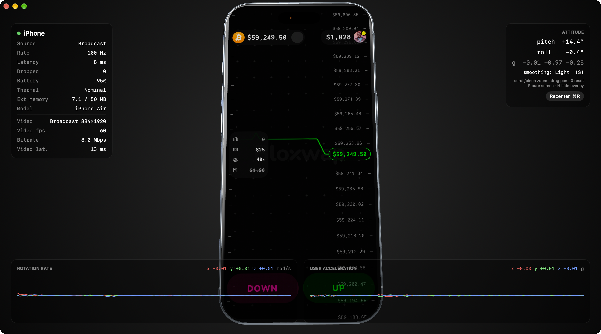

# Projector



Projector shows your iPhone on a big screen as a live 3D object. Pick up the phone and the model on the projector turns, tilts and jolts with it, while the phone's real screen plays on the model's display. Panels around it show the sensor data in real time.

It's built for demos, talks and app walkthroughs, where a flat mirrored rectangle doesn't show how the device is actually being held and used.

## Features

- **The phone in 3D.** A 100 Hz CoreMotion stream drives a RealityKit model of the device. Apple's own model is used where one exists; other devices get a procedural body.
- **The screen on the model.** Whatever is on the phone plays on the model's display, wired or wireless.
- **Works over any app.** A ReplayKit broadcast extension keeps motion and video streaming after you leave the companion app.
- **Telemetry overlay.** Source, rate, latency, dropped packets, battery, thermal state, extension memory, video resolution, fps, bitrate and latency, pitch/roll/gravity, and live graphs of rotation rate and acceleration.
- **Smoothing that adapts.** A One Euro filter removes hand tremor when the phone is held still and backs off when it moves, so motion stays responsive.
- **Pure screen mode.** The phone's screen alone, fullscreen, with nothing else on the display.
- **Zoom and pan.** Scroll or pinch zooms toward the cursor; drag pans.
- **No setup.** The Mac advertises itself over Bonjour and the phone finds it automatically.

## How it works

```
┌──────────── iPhone ────────────────────────────┐              ┌──────────── Mac (fullscreen) ──────────────────┐
│ Companion app ─┐                               │  UDP :47800  │ TelemetryReceiver ─► TelemetryHub               │
│                ├─ CoreMotion 100 Hz ─► MacLink ├─────────────►│   (pick source · One Euro filter · recenter)   │
│ Broadcast ext ─┘                               │  Bonjour     │                         │                      │
│   ReplayKit frames ─► HEVC (VideoToolbox) ──── ├─────────────►│ VideoReceiver ─► HW decode ─┐                  │
│                                  VideoLink     │  TCP :47800  │ USBScreenCapture (cable) ──┤ VideoFrameStore  │
└────────────────────────────────────────────────┘              │                             ▼                  │
          └──── USB cable (QuickTime-style capture) ───────────►│ RealityKit stage: device model + live screen   │
                                                                │ SwiftUI HUD · PureScreenView                   │
                                                                └────────────────────────────────────────────────┘
```

| Channel | Transport | Notes |
|---|---|---|
| Motion | UDP, Bonjour `_phoneproj._udp`, port 47800 | 92-byte binary packets at 100 Hz: attitude quaternion, rotation rate, user acceleration, gravity, magnetic field |
| Status | Same UDP flow, 1 Hz | Battery, thermal state, ReplayKit fps, extension memory, model identifier, device name |
| Video (wireless) | TCP 47800, length-prefixed | Hardware HEVC (falls back to H.264), real-time, no frame reordering. If the network backs up it drops frames until the next keyframe instead of adding latency. |
| Video (wired) | CoreMediaIO / AVFoundation | A cabled device appears as a capture device, the same way QuickTime records an iPhone screen. Full native resolution, 60 fps. Used in preference to wireless when connected. |

Motion and video run on separate channels so a congested video stream can never delay orientation updates.

### Measured on an iPhone Air

| | Wireless (broadcast) | USB |
|---|---|---|
| Motion | 100 Hz, ~8 ms | 100 Hz |
| Video | 884×1920, up to 60 fps, 1–8 Mbps, ~13 ms | 1260×2736, 60 fps |
| Broadcast extension memory | 5–7 MB of the ~50 MB limit | — |

## Requirements

- macOS 15+ and Xcode 26+ (developed on macOS 27.2 / Xcode 27.2)
- iOS 18+ on iPhone or iPad
- [XcodeGen](https://github.com/yonaskolb/XcodeGen) (`brew install xcodegen`)
- An Apple Developer team, because the app and the broadcast extension share an App Group

## Setup

```sh
cd Projector
xcodegen generate
open Projector.xcodeproj
```

1. In `project.yml`, set `DEVELOPMENT_TEAM` to your team, and change the bundle IDs and App Group if needed.
2. Run **ProjectorMac** on the Mac and **ProjectorPhone** on the device.
3. On the phone, allow Local Network access. On the Mac, allow Camera access, which macOS requires for USB screen capture.

### Device models (optional)

For a realistic body, put Apple's AR Quick Look models in `~/Library/Application Support/Projector/Models`, or point `PROJECTOR_MODELS` at another folder:

| Device | File | Source |
|---|---|---|
| iPhone Air | `iphone-air-e-sim.usdz` | apple.com/iphone-air ("View in AR") |
| iPhone 17 | `iphone-17-e-sim.usdz` | apple.com/iphone-17 |
| iPad (A16) | `ipad-11-silver.usdz` | apple.com/ipad-11 |

The app finds the display mesh in each model, rotates the model into the device's coordinate frame, and puts the live video on its screen. Devices without a model use a procedural body.

> These models are Apple's copyrighted assets. They're loaded at runtime and are intentionally **not** bundled with the app or checked into the repo. Don't redistribute them.

## Usage

1. Open **Projector** on the Mac. It launches fullscreen.
2. Open **Projector** on the phone. Motion starts streaming right away.
3. To show the screen:
   - **Wired:** plug the phone into the Mac. The screen appears with no extra steps.
   - **Wireless, or over other apps:** tap the broadcast button in the phone app and choose **Projector Broadcast → Start Broadcast**.
4. Hold the phone the way you want it to face the audience and press **⌘R** to recenter.

### Controls

| Key / gesture | Action |
|---|---|
| Scroll / pinch | Zoom toward the cursor |
| Drag | Pan |
| `0` / double-click | Reset view |
| `+` / `-` | Step zoom |
| `F` | Pure screen mode (`Esc` exits) |
| `H` | Hide or show the overlay |
| `S` | Cycle smoothing: Off / Light / Medium / Heavy |
| `⌘R` | Recenter orientation |

### Smoothing levels

| Level | Jitter removed at rest | Lag on a 180°/s turn |
|---|---|---|
| Off | — | 0 ms |
| **Light** (default) | ~88% | ~32 ms |
| Medium | ~93% | ~57 ms |
| Heavy | ~97% | ~103 ms |

Values come from simulated hand tremor and sensor noise at 100 Hz.

### Environment variables (Mac)

| Variable | Effect |
|---|---|
| `PROJECTOR_WINDOWED=1` | Don't enter fullscreen on launch |
| `PROJECTOR_NO_USB=1` | Turn off USB capture, to test the wireless path on its own |
| `PROJECTOR_MODELS=/path` | Load device models from another folder |

When you run the binary from a terminal, it logs a `[stats]` line every ~2 seconds. Lines starting with `[phone:Broadcast]` are diagnostics sent from the broadcast extension (encoder counters, connection state, memory).

## Project layout

```
Projector/
├── project.yml              XcodeGen spec (3 targets)
├── Shared/Wire.swift        Binary wire protocol (iOS + macOS)
├── PhoneShared/             Used by both the iOS app and the extension
│   ├── MacLink.swift          Bonjour discovery, UDP link, reconnects on path changes
│   ├── TelemetryStreamer.swift CoreMotion 100 Hz + status packets
│   └── DeviceInfo.swift       Model identifier, memory footprint
├── PhoneApp/                Companion app (streams while open, broadcast picker)
├── BroadcastExtension/      ReplayKit upload extension
│   ├── SampleHandler.swift    Motion + video, heartbeat diagnostics
│   ├── VideoEncoder.swift     HEVC/H.264, backpressure, session recovery
│   └── VideoLink.swift        TCP video channel
└── MacApp/
    ├── TelemetryReceiver.swift / TelemetryHub.swift   Ingest, source selection, filtering, recenter
    ├── MotionSmoothing.swift   One Euro orientation filter + jolt filter
    ├── VideoReceiver.swift     TCP video + hardware decode, multi-source frame store
    ├── USBScreenCapture.swift  Wired screen capture via CoreMediaIO
    ├── VideoTexture.swift      CVPixelBuffer → RealityKit LowLevelTexture (GPU blit)
    ├── DeviceModels.swift      Model identifier → Apple USDZ, auto-normalization
    ├── PhoneEntity.swift       Procedural fallback bodies
    ├── StageView.swift / StageControls.swift / StageInput.swift   3D stage, zoom/pan
    ├── PureScreenView.swift    Zero-copy fullscreen video
    └── HUDView.swift           Telemetry overlay
```

## Known limitations

- **Position isn't tracked.** The model rotates and jolts but doesn't move through space. True 6DoF needs ARKit, which only runs in the foreground app and not inside the broadcast extension.
- **Wireless video is lower resolution.** ReplayKit delivers 884×1920 on iPhone Air; use USB for full resolution.
- **Some devices have no Apple model.** These include iPhone 17 Pro, iPhone 16e, iPad mini and Apple Watch. The iPad Pro and iPad Air AR models include a Magic Keyboard, so they aren't used. These devices get the procedural body.
- **One phone at a time.** If several phones stream at once, their motion is mixed into the same source.
- **Background streaming needs the broadcast.** Without it, iOS suspends the companion app in the background and motion stops.
